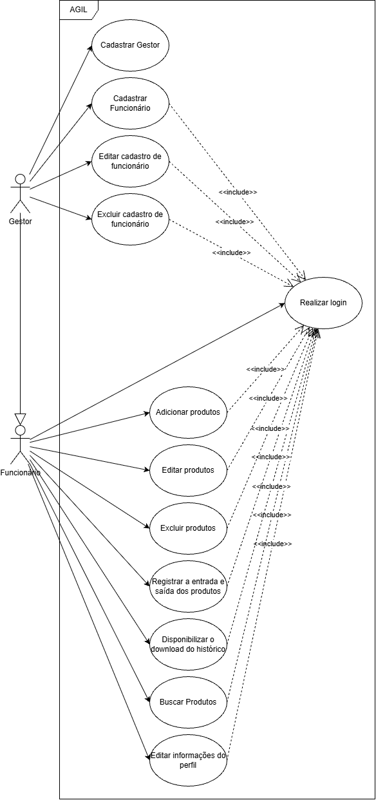

# Casos de Uso do Sistema A.G.I.L

Casos de uso conforme o documento **Projeto Integrador** (seção 8).

**Atores:** Gestor e Funcionário. O Gestor herda as ações do Funcionário e também gerencia os cadastros de funcionários.

## Diagrama de casos de uso

*Fonte: elaborado pelos autores (2026).*

Todos os casos de uso, exceto o cadastro de gestor e o próprio login, incluem (`<<include>>`) o caso **Realizar login**.

## Índice

| ID | Caso de uso | Atores | Prioridade |
|---|---|---|---|
| [UC_01](#uc_01--cadastrar-gestor) | Cadastrar Gestor | Gestor | Essencial |
| [UC_02](#uc_02--cadastrar-funcionário) | Cadastrar Funcionário | Gestor | Essencial |
| [UC_03](#uc_03--editar-cadastro-de-funcionário) | Editar cadastro de funcionário | Gestor | Importante |
| [UC_04](#uc_04--excluir-cadastro-de-funcionário) | Excluir cadastro de funcionário | Gestor | Importante |
| [UC_05](#uc_05--realizar-login) | Realizar login | Gestor e Funcionário | Essencial |
| [UC_06](#uc_06--adicionar-produtos) | Adicionar produtos | Gestor e Funcionário | Essencial |
| [UC_07](#uc_07--editar-produtos) | Editar produtos | Gestor e Funcionário | Essencial |
| [UC_08](#uc_08--excluir-produtos) | Excluir produtos | Gestor e Funcionário | Essencial |
| [UC_09](#uc_09--registrar-entrada-e-saída-de-produtos) | Registrar a entrada e saída dos produtos | Gestor e Funcionário | Essencial |
| [UC_10](#uc_10--disponibilizar-o-download-do-histórico) | Disponibilizar o download do histórico | Gestor e Funcionário | Importante |
| [UC_11](#uc_11--buscar-produtos) | Buscar produtos | Gestor e Funcionário | Desejável |
| [UC_12](#uc_12--editar-informações-do-perfil) | Editar informações do perfil | Gestor e Funcionário | Importante |

---

## UC_01 – Cadastrar Gestor

| Campo | Descrição |
|---|---|
| Atores | Gestor |
| Prioridade | Essencial |
| Pré-condição | O gestor precisa ter as informações da empresa e um e-mail. |
| Pós-condição | Gestor cadastrado com sucesso e com permissões de gestor. |

**Fluxo principal**
1. Gestor acessa o sistema AGIL.
2. Gestor acessa a página de login através do botão "Login".
3. Gestor acessa a página de cadastro através do botão "Cadastrar-se".
4. Gestor preenche todas as informações de cadastro necessárias.
5. Aceita os termos de uso e a política de privacidade.
6. Finaliza o cadastro por meio do botão "Criar conta".
7. O sistema realiza o cadastro do gestor.

**Fluxos secundários**
- **FS001:** e-mail utilizado já possui cadastro no sistema. O sistema mostra mensagem explicando o problema e o gestor tenta novamente corrigir.
- **FS002:** informações da empresa, como CNPJ, já estão cadastradas ou são inválidas. O sistema mostra mensagem explicando o problema e o gestor tenta novamente corrigir.

---

## UC_02 – Cadastrar Funcionário

| Campo | Descrição |
|---|---|
| Atores | Gestor |
| Prioridade | Essencial |
| Pré-condição | O gestor precisa estar logado no sistema. |
| Pós-condição | Novo funcionário cadastrado com sucesso. |

**Fluxo principal**
1. Gestor acessa o sistema AGIL.
2. Gestor realiza o login no sistema.
3. Gestor acessa a página de funcionários através da sidebar.
4. Gestor acessa a página de criação de funcionário através do botão "+".
5. Gestor preenche todas as informações de cadastro necessárias.
6. Finaliza o cadastro por meio do botão "Cadastrar funcionário".
7. O sistema realiza o cadastro do novo funcionário.

**Fluxos secundários**
- **FS001:** um campo obrigatório vazio é detectado. O sistema mostra mensagem explicando o problema e o gestor tenta novamente corrigir.
- **FS002:** informações únicas, como CPF, já cadastradas ou inválidas. O sistema mostra mensagem explicando o problema e o gestor tenta novamente corrigir.

**Diagrama de sequência:** [`diagramas/sequencia-cadastro-funcionario.png`](diagramas/sequencia-cadastro-funcionario.png)

---

## UC_03 – Editar cadastro de funcionário

| Campo | Descrição |
|---|---|
| Atores | Gestor |
| Prioridade | Importante |
| Pré-condição | O gestor precisa estar logado no sistema. |
| Pós-condição | Dados do funcionário são editados com sucesso. |

**Fluxo principal**
1. Gestor acessa o sistema AGIL.
2. Gestor realiza o login no sistema.
3. Gestor acessa a página de funcionários através da sidebar.
4. Gestor acessa a página de edição dos dados do funcionário através do botão de lápis.
5. Gestor digita o id do funcionário que deseja editar.
6. Gestor realiza todas as mudanças necessárias.
7. Finaliza a edição por meio do botão "Salvar".
8. O sistema realiza as mudanças no cadastro do funcionário.

**Fluxos secundários**
- **FS001:** funcionário correspondente não existe. O sistema mostra mensagem explicando o problema e o gestor tenta novamente corrigir.
- **FS002:** informações editadas são inválidas (como novo CPF inválido) ou estão em branco. O sistema mostra mensagem explicando o problema e o gestor tenta novamente corrigir.

---

## UC_04 – Excluir cadastro de funcionário

| Campo | Descrição |
|---|---|
| Atores | Gestor |
| Prioridade | Importante |
| Pré-condição | O gestor precisa estar logado no sistema. |
| Pós-condição | O cadastro do funcionário é excluído com sucesso. |

**Fluxo principal**
1. Gestor acessa o sistema AGIL.
2. Gestor realiza o login no sistema.
3. Gestor acessa a página de funcionários através da sidebar.
4. Gestor acessa a página de exclusão do cadastro do funcionário através do botão de lixeira.
5. Gestor digita o id do funcionário que deseja excluir.
6. Confirma a exclusão por meio do botão "Excluir".
7. O sistema realiza a exclusão do cadastro do funcionário.

---

## UC_05 – Realizar login

| Campo | Descrição |
|---|---|
| Atores | Gestor e Funcionário |
| Prioridade | Essencial |
| Pré-condição | O usuário precisa estar cadastrado no sistema. |
| Pós-condição | Usuário logado no sistema e com suas devidas permissões. |

**Fluxo principal**
1. Usuário acessa o sistema AGIL.
2. Usuário acessa a página de login através do botão "Login".
3. Usuário preenche todas as informações de login necessárias.
4. O sistema realiza o login do usuário.

**Fluxos secundários**
- **FS001:** usuário correspondente não existe. O sistema mostra mensagem explicando o problema e o usuário tenta novamente corrigir.
- **FS002:** um campo obrigatório vazio é detectado. O sistema mostra mensagem explicando o problema e o usuário tenta novamente corrigir.

---

## UC_06 – Adicionar produtos

| Campo | Descrição |
|---|---|
| Atores | Gestor e Funcionário |
| Prioridade | Essencial |
| Pré-condição | O usuário precisa estar logado no sistema e ter as informações principais sobre o produto. |
| Pós-condição | Cadastro de um novo produto adicionado no sistema. |

**Fluxo principal**
1. Usuário acessa o sistema AGIL.
2. Usuário realiza o login no sistema.
3. Usuário acessa a página de produtos através da sidebar.
4. Usuário acessa a página de cadastro de produtos através do botão "+" na navbar de produtos.
5. Usuário preenche todas as informações de cadastro necessárias.
6. Finaliza o cadastro por meio do botão "Cadastrar produto".
7. O sistema realiza o cadastro do novo produto.

**Fluxos secundários**
- **FS001:** um campo obrigatório vazio é detectado. O sistema mostra mensagem explicando o problema e o usuário tenta novamente corrigir.
- **FS002:** o sistema identifica id já existente. O sistema mostra mensagem explicando o problema e o usuário tenta novamente corrigir.

---

## UC_07 – Editar produtos

| Campo | Descrição |
|---|---|
| Atores | Gestor e Funcionário |
| Prioridade | Essencial |
| Pré-condição | O usuário precisa estar logado no sistema e ter as informações principais sobre o produto. |
| Pós-condição | Cadastro de um antigo produto editado no sistema. |

**Fluxo principal**
1. Usuário acessa o sistema AGIL.
2. Usuário realiza o login no sistema.
3. Usuário acessa a página de produtos através da sidebar.
4. Usuário acessa a página de edição de produto através do botão de caneta na navbar.
5. Usuário edita todas as informações de cadastro necessárias.
6. Finaliza a edição por meio do botão "Atualizar produto".
7. O sistema atualiza as informações de um produto já cadastrado.

**Fluxos secundários**
- **FS001:** um campo obrigatório vazio é detectado. O sistema mostra mensagem explicando o problema e o usuário tenta novamente corrigir.
- **FS002:** o sistema identifica id ou informação igual à anterior. O sistema mostra mensagem explicando o problema e o usuário tenta novamente corrigir.

---

## UC_08 – Excluir produtos

| Campo | Descrição |
|---|---|
| Atores | Gestor e Funcionário |
| Prioridade | Essencial |
| Pré-condição | O usuário precisa estar logado no sistema. |
| Pós-condição | Exclusão de um antigo produto no sistema. |

**Fluxo principal**
1. Usuário acessa o sistema AGIL.
2. Usuário realiza o login no sistema.
3. Usuário acessa a página de produtos através da sidebar.
4. Usuário acessa a página de exclusão de produto através do botão de excluir na navbar de produtos.
5. Usuário escolhe o produto que deseja excluir e confirma a exclusão.
6. O sistema atualiza a lista de produtos cadastrados, excluindo o produto.

**Fluxos secundários**
- **FS001:** produto correspondente não existe. O sistema mostra mensagem explicando o problema e o usuário tenta novamente corrigir.

---

## UC_09 – Registrar entrada e saída de produtos

| Campo | Descrição |
|---|---|
| Atores | Gestor e Funcionário |
| Prioridade | Essencial |
| Pré-condição | O usuário precisa estar logado no sistema e ter produtos já cadastrados. |
| Pós-condição | Registro de entrada e saída dos produtos. |

**Fluxo principal**
1. Usuário acessa o sistema AGIL.
2. Usuário realiza o login no sistema.
3. Usuário acessa a página de produtos através da sidebar.
4. Usuário clica no produto correspondente que deseja registrar a entrada ou saída.
5. Usuário seleciona a entrada ou saída do produto.
6. Finaliza a seleção por meio do botão "Finalizar".
7. O sistema atualiza a entrada ou saída do produto no histórico.

**Fluxos secundários**
- **FS001:** produto correspondente não existe. O sistema mostra mensagem explicando o problema e o usuário tenta novamente corrigir.

**Diagrama de sequência:** [`diagramas/sequencia-movimentacao-estoque.png`](diagramas/sequencia-movimentacao-estoque.png)

---

## UC_10 – Disponibilizar o download do histórico

| Campo | Descrição |
|---|---|
| Atores | Gestor e Funcionário |
| Prioridade | Importante |
| Pré-condição | O usuário precisa estar logado no sistema e ter realizado alguma movimentação no histórico. |
| Pós-condição | Download do histórico de movimentação do sistema. |

**Fluxo principal**
1. Usuário acessa o sistema AGIL.
2. Usuário realiza o login no sistema.
3. Usuário acessa a página de histórico através da sidebar.
4. Usuário realiza o download por meio do botão com o ícone de download na navbar de histórico.
5. O download é realizado.

**Fluxos secundários**
- **FS001:** nenhuma movimentação foi detectada no sistema. O sistema mostra mensagem explicando o problema e o usuário realiza alguma movimentação antes de baixar o histórico.

---

## UC_11 – Buscar produtos

| Campo | Descrição |
|---|---|
| Atores | Gestor e Funcionário |
| Prioridade | Desejável |
| Pré-condição | O usuário precisa estar logado no sistema. |
| Pós-condição | Busca do produto encontrado. |

**Fluxo principal**
1. Usuário acessa o sistema AGIL.
2. Usuário realiza o login no sistema.
3. Usuário acessa a página de produtos através da sidebar.
4. Usuário clica na navbar de busca.
5. Usuário faz a busca do produto que deseja.
6. O sistema traz o produto desejado.

**Fluxos secundários**
- **FS001:** produto não está cadastrado no sistema. O sistema mostra mensagem explicando o problema e o usuário tenta novamente corrigir.
- **FS002:** o sistema não consegue encontrar o produto desejado. O sistema mostra mensagem explicando o problema e o usuário tenta novamente corrigir.

---

## UC_12 – Editar informações do perfil

| Campo | Descrição |
|---|---|
| Atores | Gestor e Funcionário |
| Prioridade | Importante |
| Pré-condição | O usuário precisa estar logado no sistema. |
| Pós-condição | Informações do perfil editadas. |

**Fluxo principal**
1. Usuário acessa o sistema AGIL.
2. Usuário realiza o login no sistema.
3. Usuário acessa a página de início através da sidebar.
4. Usuário acessa a página de edição do perfil clicando em sua imagem, no canto superior direito.
5. Usuário edita as informações do perfil.
6. Usuário confirma a edição das informações do perfil.
7. O sistema atualiza as informações que foram alteradas no perfil.

**Fluxos secundários**
- **FS001:** um campo obrigatório vazio é detectado. O sistema mostra mensagem explicando o problema e o usuário tenta novamente corrigir.
- **FS002:** o sistema identifica alguma informação já existente. O sistema mostra mensagem explicando o problema e o usuário tenta novamente corrigir.
