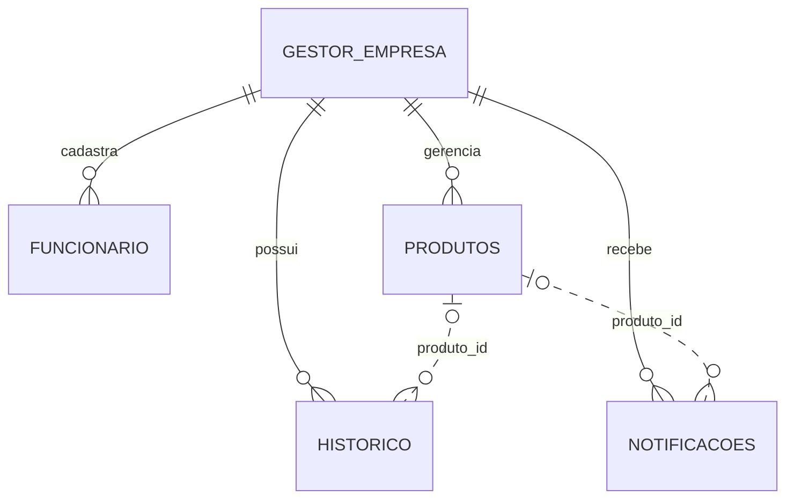
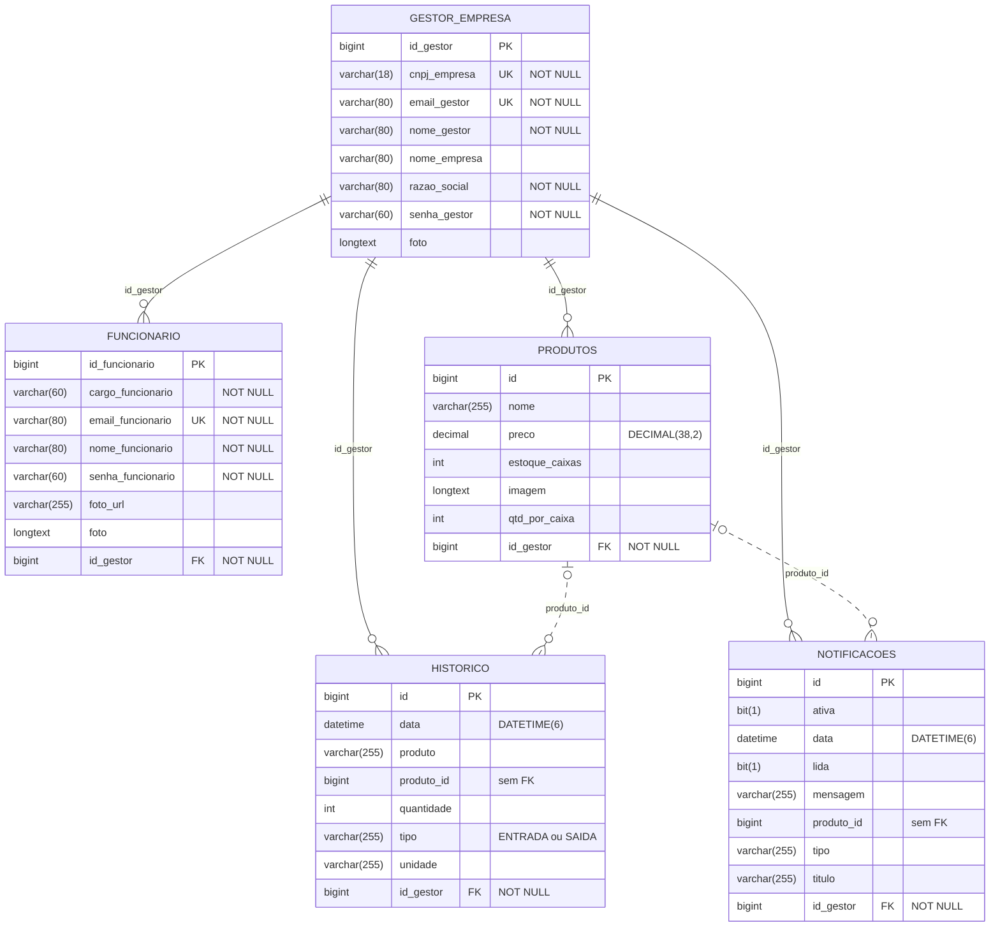

# DER e Modelo Lógico – A.G.I.L

Modelos do banco de dados **`agildb`**, de acordo com o script [`database/schema.sql`](../../database/schema.sql). Os diagramas são renderizados automaticamente pelo GitHub.

## 1. DER (modelo conceitual)

Visão das entidades e dos relacionamentos. Linha contínua indica chave estrangeira no banco; linha pontilhada indica referência lógica, sem chave estrangeira.

### Cardinalidades

| Relacionamento | Entidade A | Entidade B | Cardinalidade |
|---|---|---|---|
| cadastra | `GESTOR_EMPRESA` | `FUNCIONARIO` | (1,1) para (0,N) |
| gerencia | `GESTOR_EMPRESA` | `PRODUTOS` | (1,1) para (0,N) |
| possui | `GESTOR_EMPRESA` | `HISTORICO` | (1,1) para (0,N) |
| recebe | `GESTOR_EMPRESA` | `NOTIFICACOES` | (1,1) para (0,N) |
| produto_id | `PRODUTOS` | `HISTORICO` | (0,1) para (0,N), sem FK |
| produto_id | `PRODUTOS` | `NOTIFICACOES` | (0,1) para (0,N), sem FK |

## 2. Modelo lógico

Tabelas, colunas, tipos e chaves. Os detalhes de cada campo estão no [dicionário de dados](../dicionario-de-dados.md).

**Legenda:** PK = chave primária · FK = chave estrangeira · UK = valor único.

## 3. Restrições de integridade

- **UNIQUE:** `gestor_empresa.cnpj_empresa`, `gestor_empresa.email_gestor` e `funcionario.email_funcionario`.
- **NOT NULL:** campos marcados no modelo lógico.
- **FOREIGN KEY:** `id_gestor` em `funcionario`, `produtos`, `historico` e `notificacoes`, todas apontando para `gestor_empresa.id_gestor`.

Os testes dessas restrições estão em [`database/testes_integridade.sql`](../../database/testes_integridade.sql).
