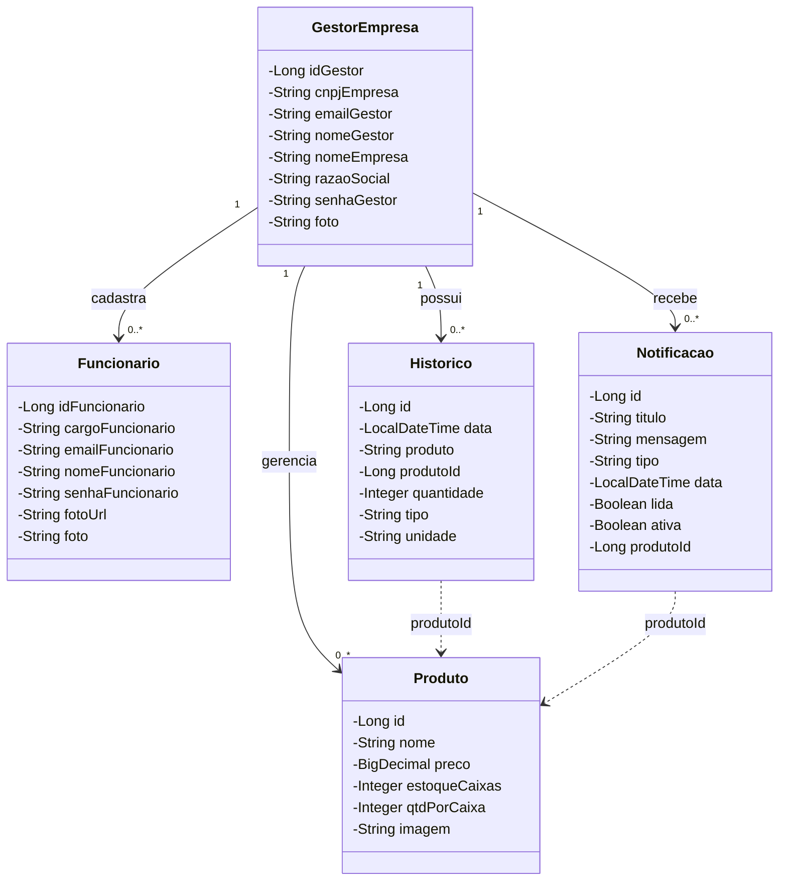

# Diagrama de Classes – A.G.I.L

Diagrama de classes das **entidades de domínio** do sistema, derivado do banco de dados ([`database/schema.sql`](../../database/schema.sql)). Cada classe corresponde a uma tabela e cada atributo a uma coluna.

> **Atenção:** os nomes das classes e dos atributos seguem as tabelas e colunas do banco. Confira com as entidades JPA do `back-end-AGIL` e ajuste se algum nome for diferente.

## Relacionamentos

| Origem | Destino | Cardinalidade | Observação |
|---|---|---|---|
| `GestorEmpresa` | `Funcionario` | 1 para 0..N | Chave estrangeira `id_gestor` |
| `GestorEmpresa` | `Produto` | 1 para 0..N | Chave estrangeira `id_gestor` |
| `GestorEmpresa` | `Historico` | 1 para 0..N | Chave estrangeira `id_gestor` |
| `GestorEmpresa` | `Notificacao` | 1 para 0..N | Chave estrangeira `id_gestor` |
| `Historico` | `Produto` | N para 0..1 | Referência pelo atributo `produtoId`, sem chave estrangeira no banco |
| `Notificacao` | `Produto` | N para 0..1 | Referência pelo atributo `produtoId`, sem chave estrangeira no banco |

## Valores do atributo `tipo` (Historico)

- `ENTRADA`: entrada de produtos no estoque
- `SAIDA`: saída de produtos do estoque

Os tipos de cada campo estão detalhados no [dicionário de dados](../dicionario-de-dados.md).
